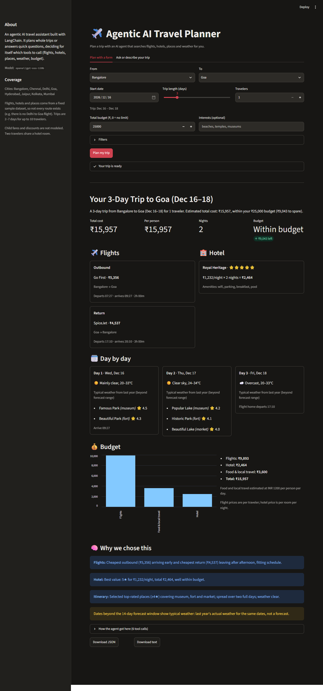
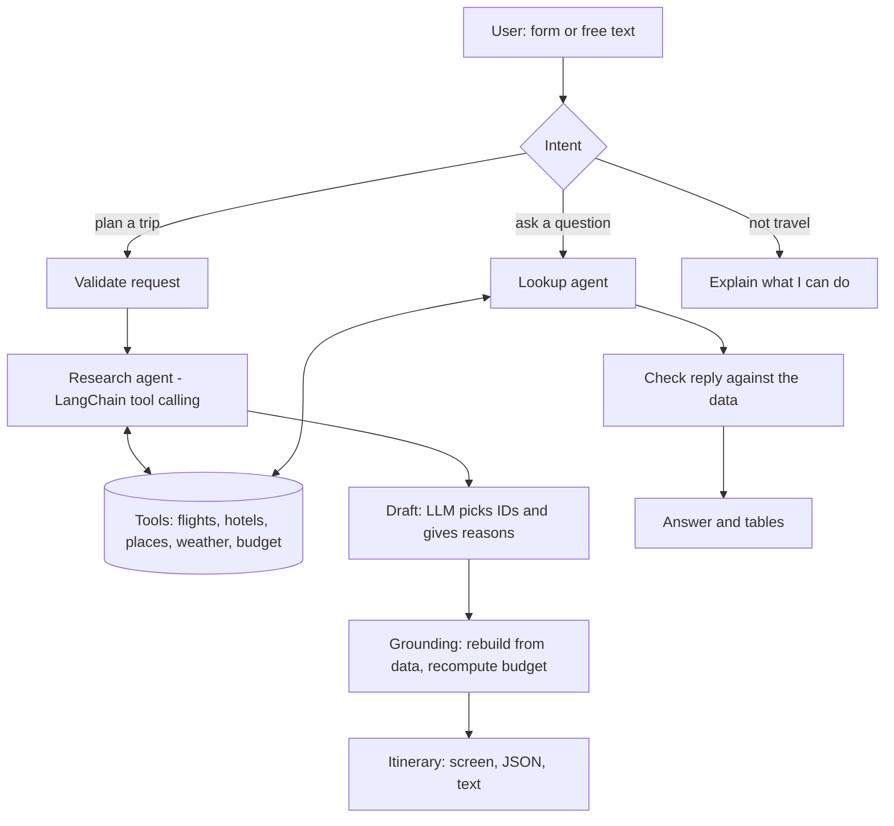

# Agentic AI Travel Planner

An agentic AI assistant, built with **LangChain** and **Streamlit**, that plans complete trips and answers quick
travel questions. Give it a trip in plain English ("3-day trip from Bangalore to Goa from 5 December, budget
25,000") or fill in a form, and an AI agent decides on its own which tools to call (flights, hotels, places,
weather, budget), then returns a clear itinerary with costs and the reasoning behind each choice.



## Contents

1. [Problem and business use case](#problem-and-business-use-case)
2. [Features](#features)
3. [How it works](#how-it-works)
4. [Project structure](#project-structure)
5. [Setup](#setup)
6. [Usage](#usage)
7. [Data and assumptions](#data-and-assumptions)
8. [Design decisions](#design-decisions)
9. [Error handling](#error-handling)
10. [Testing and code quality](#testing-and-code-quality)
11. [Known limitations and future work](#known-limitations-and-future-work)
12. [Deployment](#deployment)
13. [Troubleshooting](#troubleshooting)

## Problem and business use case

Planning a trip means switching between flight sites, hotel sites, weather apps and attraction lists, then
adding up the cost by hand. Travel companies also spend support time answering the same questions: "what is the
cheapest hotel in Goa?", "can I fly from Delhi to Goa?".

This project replaces that manual work with one assistant that:

* understands a traveller's request in natural language,
* **autonomously chooses and sequences tools** to gather flights, hotels, places and weather,
* compares options (cheapest or fastest flight, best-value hotel, highest-rated places),
* checks the cost against the traveller's budget, and
* explains why it chose what it chose.

Business value: faster, personalised itineraries; fewer repetitive support queries; transparent recommendations.

## Features

**Trip planning**
* Free-text or structured form input, for 2 to 7 day trips and up to 10 travelers.
* Understands round trips, one-way trips, "staying with friends" (no hotel), groups (rooms are computed), and
  requests written in other languages (tested with Bengali).
* A trip summary, then a day-by-day itinerary with weather, places and flight timings; budget breakdown (flights, hotel, food and local
  travel); "Why we chose this" reasoning; JSON and text download.
* Keeps planning when something is missing: an unavailable flight or hotel is reported and the rest of the plan is
  still built. The agent is also instructed to relax strict hotel filters and to try a cheaper option when a trip
  is over budget.

**Quick questions**
* "Cheapest hotels in Goa with a pool", "Flights from Bangalore to Goa", "Where can I fly from Delhi?",
  "Things to do in Jaipur", "Weather in Mumbai this weekend".
* **Comparisons and amenities**: "Compare hotels in Goa", "Is the fastest flight from Bangalore to Goa worth the
  extra cost?", "Which Goa hotels have a gym?". The agent picks the comparison or amenities tool and the answer
  states the trade-off (for example what the faster flight costs extra and how much time it saves).
* Each answer shows a short reply plus tables built directly from the data.

**Trustworthy output**
* The model only *chooses* items by ID; every name, price, time and total shown is rebuilt from the datasets, and
  the budget is recomputed in code. Invented flights, hotels or places are removed and reported.
* Replies in quick-answer mode are checked against the data (see [Design decisions](#design-decisions)).

## How it works



**Trip planning pipeline** (`agent/agent.py`)

1. **Understand**: free text becomes a structured request (origin, destination, dates, travelers, budget,
   preferences, one-way, hotel needed). The form skips this step.
2. **Validate** (`agent/planner.py`): unknown cities (with "did you mean"), past dates, trip length, traveler
   limits. Missing details are asked for in plain language.
3. **Research**: a LangChain tool-calling agent chooses which tools to call and in what order. Independent calls
   (both flights, weather, hotels, places) are made together; the budget check comes last.
4. **Draft**: the model states its final choices as dataset IDs plus short reasons.
5. **Ground**: Python looks every ID up in the data, rebuilds flights, hotel, places and notes, fetches or reuses
   the weather, and recomputes the budget.

**Tools** (`tools/`)

| Tool | What it does |
|---|---|
| `search_flights` | Flights between two cities, cheapest or fastest. With a date, schedules are re-dated; for today, flights that already left are excluded. Without a date, returns the daily schedule. |
| `list_flight_routes` | Where you can fly from (or to) a city, with the cheapest fare. |
| `search_hotels` | Filter by stars, price and amenities; rank by value (stars per Rs 1000), price or stars; total price for the stay. |
| `search_places` | Places by type and minimum rating, best first. If a type does not exist in a city it returns the best-rated alternatives. |
| `hotel_amenities` | What a city's hotels offer (with the cheapest hotel for each amenity), or which hotels have one amenity, cheapest first. |
| `compare_hotels` | Side-by-side hotels: price, stars, value score and amenities, with the cheapest, best-value and most-stars picks and the price gap. |
| `compare_flights` | All flights on a route: price, duration and price per hour, plus what the fastest flight costs extra and how much time it saves. |
| `get_weather_forecast` | Forecast from [Open-Meteo](https://open-meteo.com), an open-source weather API that needs no key, for the trip dates. Beyond the 14-day forecast window it returns last year's weather for the same dates, labelled as typical. |
| `estimate_budget` | Flights + hotel + food and local travel, compared with the user's limit. |

## Project structure

```
travel-planner/
├── app.py                  # Streamlit UI
├── cli.py                  # Command-line interface
├── config.py               # Settings (model, API URLs, city aliases)
├── data_loader.py          # Loads, validates and normalises the JSON datasets
├── ui_helpers.py           # Pure UI helpers (preferences text, result tables)
├── agent/
│   ├── agent.py            # Intent routing, research agent, quick-answer agent, retries
│   ├── planner.py          # Request validation and grounding of the plan
│   ├── grounding.py        # Checks quick-answer text against the data
│   ├── schemas.py          # Pydantic models (request, draft, final plan)
│   ├── prompts.py          # System prompts
│   └── formatter.py        # Readable text version of a plan
├── tools/                  # One module per LangChain tool, plus shared helpers
├── data/                   # flights.json, hotels.json, places.json, cities.json
├── tests/                  # 164 automated tests
├── docs/                   # Demo script and screenshots
├── requirements.txt        # Runtime dependencies (ranges)
├── requirements-dev.txt    # Adds the test and lint tools
├── requirements-lock.txt   # Exact tested versions
└── pyproject.toml          # Lint and test configuration
```

## Setup

Requires **Python 3.10 or newer** and a free **Groq API key** from <https://console.groq.com>.

```bash
# 1. Create and activate a virtual environment
python -m venv venv
venv\Scripts\activate            # Windows
# source venv/bin/activate       # macOS / Linux

# 2. Install dependencies
pip install -r requirements.txt            # app only. For tests and lint too: requirements-dev.txt
#                                            (requirements-lock.txt pins the exact tested versions)

# 3. Add your API key
copy .env.example .env                     # Windows  (cp .env.example .env on macOS / Linux)
# then edit .env:  GROQ_API_KEY=gsk_your_key_here
```

Optional settings in `.env`:

| Variable | Default | Meaning |
|---|---|---|
| `GROQ_API_KEY` | none (required) | Your Groq key |
| `GROQ_MODEL` | `openai/gpt-oss-120b` | Model id. Check <https://console.groq.com/docs/models>; some models are enterprise-only. |
| `GROQ_REASONING_EFFORT` | `low` | `low`, `medium` or `high` (gpt-oss models only). Lower is faster. |

## Usage

**Web app**

```bash
streamlit run app.py
```

Opens at <http://localhost:8501>. Use **Plan with a form** for a structured request (with filters for flight
speed, hotel stars and amenities, one-way, and "no hotel needed"), or **Ask or describe your trip** to type a
trip or a question.

Example inputs for the text box:

```
Plan a 3 day trip from Bangalore to Goa starting 5 December, budget 25000
Plan a 4 day trip from Hyderabad to Goa starting 12 December for 2 people, budget 40000
Cheapest hotels in Goa with a pool
Where can I fly from Delhi?
```

**Command line**

```bash
python cli.py "Plan a 3 day trip from Bangalore to Goa starting 5 December, budget 25000" --steps --json
python cli.py "Cheapest hotels in Goa with a pool"
```

## Data and assumptions

The provided sample datasets are used as they are: `flights.json` (30), `hotels.json` (40), `places.json` (40),
for 8 cities (Bangalore, Chennai, Delhi, Goa, Hyderabad, Jaipur, Kolkata, Mumbai). `data/cities.json` adds
coordinates for the weather API. Weather comes live from [Open-Meteo](https://open-meteo.com) (no key needed).

Things to know about the sample data (these are properties of the data, not bugs):

* **Flights**: only 25 of the 56 possible one-way routes exist, so some trips (for example Delhi to Goa) have no
  flight; the planner says so and still plans the hotel, places and weather. Flights are dated 2025, so they are
  treated as recurring daily schedules and re-dated to the traveller's dates.
* **Hotels**: have stars but no guest ratings, and prices do not track stars; hotels are ranked by a transparent
  "value score" (stars per Rs 1000 per night).
* **Places**: names are generic ("Famous Fort") and many do not match their type; each city has only five. The app
  shows them exactly as given and never adds places from outside the dataset.

Assumptions in the budget (shown to the user): food and local travel Rs 1200 per person per day; two travelers
share a room; flight prices are per traveler; child fares are not modelled.

## Design decisions

* **Grounding over trust.** LLMs invent plausible details. The model therefore only returns IDs and reasons; all
  displayed facts are rebuilt from the data, the budget is recomputed in code, and anything not in the dataset is
  dropped with a short note. In a live test the agent invented real attractions from its own knowledge; the
  grounding step removed them.
* **Quick answers are checked.** Tables come straight from tool results. The model's sentence above them is
  checked: place names that are not in the data are removed, and an incomplete list of places is replaced with
  the full list from the data (it counts items, because two places can share a name).
* **Factual day notes.** Notes such as "Arrive 09:27" are built from the chosen flights, not written by the model.
* **Resilience.** The model occasionally produces a malformed tool call; those calls, rate limits and timeouts are
  retried with backoff (`ModelRetryMiddleware`). Structured output tries two methods, twice each.
* **Fallbacks keep the plan useful.** If the agent picks no places, top-rated ones are added; if a requested place
  type does not exist, the best alternatives are returned; if weather is unavailable the plan continues with a note.
* **Separation of concerns.** Tools are small and independently testable; the UI contains no business logic.
* **Data layer.** The brief provides JSON datasets, so no SQL database is used.

## Error handling

Every external call is wrapped. Tools return an `error` object (with hints such as the routes that do exist)
instead of raising, so the agent can recover. Weather failures never stop a plan. Groq errors are translated into
plain messages (invalid key, unavailable model, rate limit). The UI never shows a stack trace.

## Testing and code quality

```bash
python -m pytest -q        # 164 tests
ruff check . && ruff format --check .
```

The lint configuration also enforces small functions (complexity, branches and statements per function), in line
with the "modularize your code" guideline.

Tests cover data loading, every tool, request validation, grounding (including invented flights, hotels and
places), budget arithmetic, retries on malformed tool calls, quick-answer checks, and the Streamlit app (headless).
The agent is tested with a scripted fake model, so the suite needs no network or API key. Code follows PEP 8
(line length 120) with docstrings on all public modules, classes and functions.

## Known limitations and future work

* Trips are limited to 2 to 7 days, up to 10 travelers, and one destination per trip.
* Quick-answer checking catches place names that look like landmarks (for example "Red Fort"); it is a safeguard,
  not a proof. The tables below an answer are always correct.
* **Not implemented, because the data does not exist yet:** distance from a hotel to a landmark (the hotel and
  place data have no coordinates), and price comparison across several travel websites (there is one data source,
  the provided JSON). Both are straightforward to add once coordinates or additional sources are available: the
  tools already take their data from `data_loader.py`, so a second source is a new loader plus a merge step.
* Possible extensions: multi-city trips and connecting flights, live prices, child fares, saving and sharing
  plans, and deployment (for example Streamlit Community Cloud).

## Deployment

The app deploys to [Streamlit Community Cloud](https://share.streamlit.io) straight from this repository.

1. Push the repository to GitHub (the `data/` folder must be included; `.env` must not be).
2. At share.streamlit.io choose **New app**, pick the repository and branch, and set the main file to `app.py`.
3. Open **Advanced settings**, choose Python 3.11 or 3.12, and paste this into **Secrets** (the value must be a
   quoted string):

   ```toml
   GROQ_API_KEY = "gsk_your_key_here"
   ```

   Optional: `GROQ_MODEL = "openai/gpt-oss-120b"`. Top-level secrets are exposed to the app as environment
   variables, which is where `config.py` reads them.
4. Click **Deploy**. Dependencies are installed from `requirements.txt`.

Note: everyone who uses a public deployment shares your Groq free-tier rate limit. For a demo, keep the app
private or share the link only with reviewers.

## Troubleshooting

| Symptom | Fix |
|---|---|
| "The configured Groq model is not available" | Set `GROQ_MODEL` in `.env` to a model your key can use (see the Groq models page). |
| "Groq rejected the API key" / buttons disabled | Check `GROQ_API_KEY` in `.env`; restart the app after editing. |
| "The Groq rate limit was reached" | Wait a minute and retry. |
| Weather shows "typical weather" | The dates are beyond the 14-day forecast window; this is expected. |
| `ModuleNotFoundError` | Activate the virtual environment and run `pip install -r requirements.txt`. |
